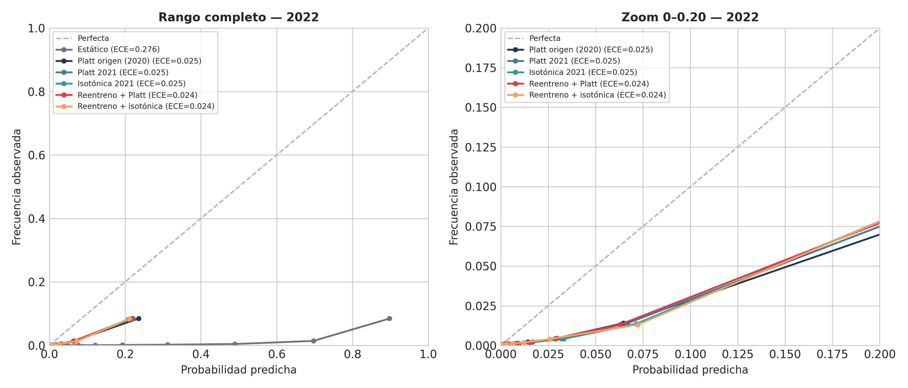
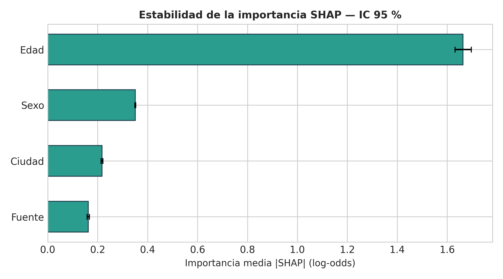
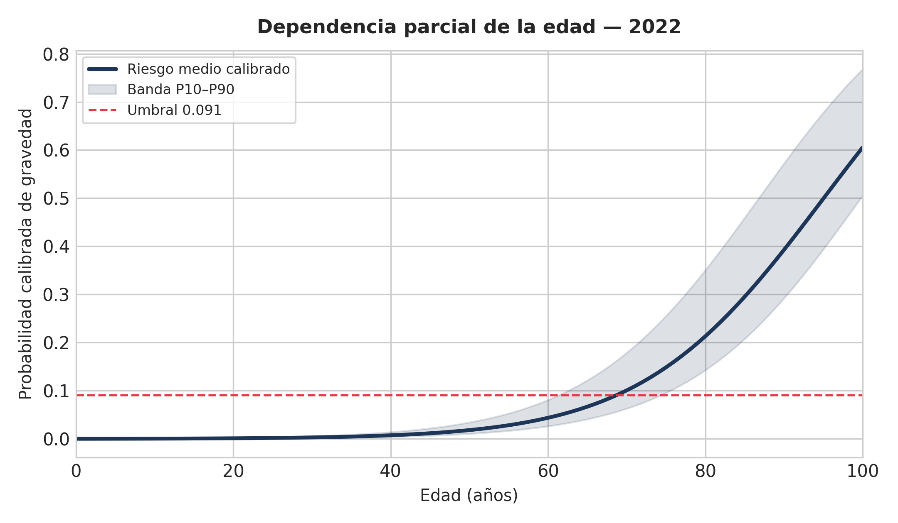
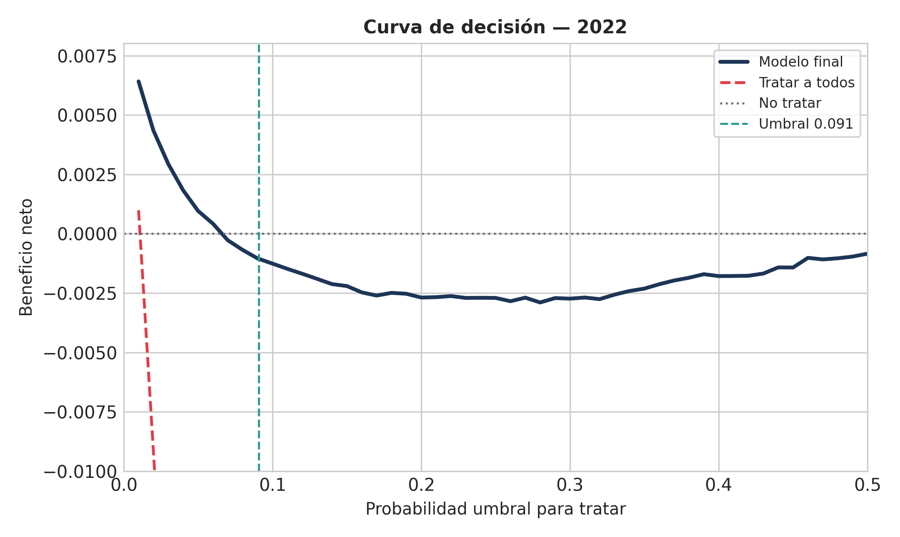
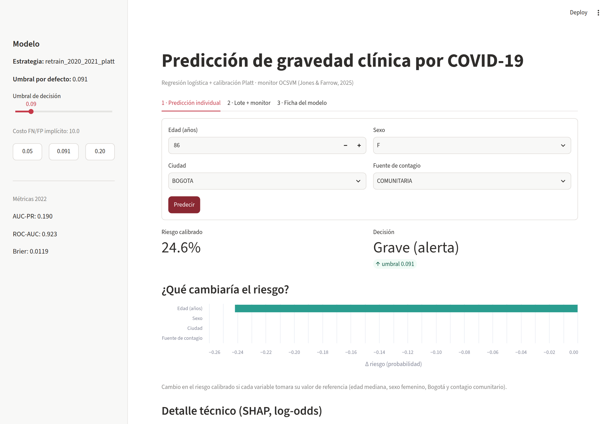

# Universidad Externado de Colombia

**Facultad:** Ciencia de Datos  
**Asignatura:** Machine Learning II, Proyecto Integrador  
**Docente:** Wilmer Darío Pineda Ríos

# Detección de *population drift* en la predicción de gravedad clínica de COVID-19 en Colombia

**Entrega Final, Fase 3: consolidación, interpretación y despliegue**

---

**Integrantes:**
- Ailyn Sofía Gómez Rodríguez
- Juan Tomás Rincón Pinzón

**Bogotá D.C., Colombia, 2026**

---

# Introducción

La fase 2 mostró que el OCSVM de Jones y Farrow (2025) no detecta el problema que más afecta al clasificador de gravedad en Colombia. La población de entrada \(P(X)\) se mantiene estable entre 2020 y 2022, pero la prevalencia cae de 2,82 % a 1,10 % y la relación entre covariables y desenlace también cambia. El monitor no supervisado de \(X\) no puede ver ninguno de esos dos cambios.

La fase 3 lleva ese diagnóstico a un sistema desplegable. El trabajo selecciona un modelo final, lo calibra para el cambio de prevalencia, lo interpreta con SHAP y lo expone en una aplicación Streamlit con Docker. El informe cubre el modelo final y la reproducción del método, la calibración, la interpretabilidad y los errores, el despliegue y las limitaciones.

# 1. Modelo final y reproducción del método

## 1.1. Datos y problema

El registro oficial de casos positivos de COVID-19 del INS (datos.gov.co, recurso `gt2j-8ykr`) tiene 6.390.844 filas. La fase 2 depuró ese registro y consolidó una muestra estratificada de 300.000 casos, 100.000 por ola: 2020 (variante ancestral), 2021 (Delta) y 2022 (Ómicron). La variable objetivo es `grave` (1 = fallecido, grave o UCI; 0 = leve o moderado). Los predictores son cuatro variables disponibles al momento del diagnóstico: `edad_anios`, `sexo`, `ciudad_top` y `fuente_tipo_contagio`. Se excluyó `tipo de atención` porque contiene el desenlace.

La partición es temporal: 2020 entrena, 2021 calibra y 2022 evalúa. El modelo base es una regresión logística con `C=0.1`, `class_weight='balanced'` y semilla 42, dentro de un `Pipeline` con `StandardScaler` y `OneHotEncoder(drop='first', handle_unknown='ignore')`. En la fase 2, la regresión logística empató estadísticamente con XGBoost, LightGBM, Random Forest y SVM-RBF; se eligió por parsimonia, estabilidad e interpretabilidad.

## 1.2. Selección y configuración final

En B4 se compararon las estrategias de calibración y adaptación. El modelo final se reentrena con **2020 completo + 80 % de 2021** (180.000 casos), se calibra con **Platt sobre el 20 % restante de 2021** (20.000 casos) y se evalúa una sola vez en 2022. El umbral de decisión iguala el costo esperado de un falso negativo con diez veces el de un falso positivo:

\[
t^* = \frac{1}{1 + C_{FN}/C_{FP}} = \frac{1}{11} = 0,0909.
\]

**Cuadro 1.** Configuración y desempeño del modelo final en 2022.

| Elemento | Valor |
|---|---|
| Modelo | Regresión logística, `C=0.1`, `class_weight='balanced'` |
| Entrenamiento | 2020 + 80 % de 2021 (180.000 casos) |
| Calibración | Platt sobre 20 % de 2021 (20.000 casos) |
| Test | 2022 (100.000 casos) |
| Umbral | 0,0909 (FN/FP = 10) |
| AUC-PR | **0,1903** |
| ROC-AUC | **0,9228** |
| Brier | 0,01192 |
| ECE | 0,02380 |
| Recall / Precision / F1 | 0,786 / 0,081 / 0,1475 |

El AUC-PR es 17,3 veces la prevalencia de 2022 (1,10 %), así que el modelo ordena bien los casos. El F1 y la precisión son bajos en términos absolutos porque la clase positiva es muy rara y el umbral prioriza no perder graves. El Cuadro 2 resume la comparación completa de estrategias.

**Cuadro 2.** Estrategias de calibración y adaptación evaluadas en 2022.

| Estrategia | Brier | ECE | AUC-PR | F1 @ 0,091 |
|---|---:|---:|---:|---:|
| Estático (modelo 2020) | 0,1631 | 0,2763 | 0,1854 | 0,1303 |
| Platt de origen (2020) | 0,0126 | 0,0254 | 0,1854 | 0,1427 |
| Platt 2021 | 0,0121 | 0,0252 | 0,1854 | 0,1426 |
| Isotónica 2021 | 0,0119 | 0,0249 | 0,1726 | 0,1303 |
| **Reentreno + Platt** | **0,0119** | **0,0238** | **0,1903** | **0,1475** |
| Reentreno + isotónica | 0,0119 | 0,0239 | 0,1683 | 0,1262 |

Un bootstrap de 300 réplicas de 30.000 casos mostró que la mejora del reentreno + Platt frente a Platt 2021 es pequeña pero consistente: AUC-PR +0,0049 [0,0004; 0,0093], Brier -0,0002 [-0,0003; -0,0002] y F1 +0,0050 [0,0019; 0,0077]. La isotónica calibra bien, pero degrada el ranking; por eso se descartó.

## 1.3. Contraste con el artículo

El método del artículo se reprodujo en dos capas. Primero, el OCSVM se replicó sobre Wisconsin Breast Cancer y se adaptó a las cohortes del INS. En 2021 y 2022 clasificó como inliers al 99,08 % y 97,99 % de los casos, y detectó el drift simulado de edad (72 % de inliers con 30 % de ruido), mientras Isolation Forest no reaccionó. Segundo, el clasificador supervisado se adaptó al cambio de prevalencia con reentreno y calibración.

La diferencia con el artículo está en el alcance. El OCSVM vigila \(P(X)\), no \(P(Y|X)\) ni \(P(Y)\). En Colombia, \(P(X)\) se mantuvo estable, pero la prevalencia y la relación entre riesgo y covariables cambiaron. Por eso el monitor no habría alertado del deterioro del clasificador. El proyecto no contradice el artículo. Lo que hace es acotar su alcance y añadir la capa supervisada que el artículo no cubre.

# 2. Calibración y cambio de prevalencia

## 2.1. El problema de calibración del modelo crudo

El modelo con `class_weight='balanced'` está descalibrado en nivel. En 2021 predice una media de 0,228 y en 2022 de 0,287, cuando las prevalencias reales son 0,0233 y 0,0110. El ECE es 0,204 y 0,276, respectivamente. El ranking es útil, pero las probabilidades no se pueden leer como riesgo absoluto.

La calibración Platt de origen, ajustada solo con predicciones out-of-fold de 2020, corrige casi toda la descalibración: Brier 0,0204 en 2021 y 0,0126 en 2022; ECE 0,002 y 0,025. El AUC-PR no cambia porque la transformación es monótona.

## 2.2. Estrategias y decisión

Se compararon cuatro familias:

1. **Estático:** modelo 2020 sin calibrar.
2. **Corrección de prevalencia por EM** (Saerens-Latinne-Decaestecker), sin etiquetas de despliegue.
3. **Calibración supervisada con 2021:** Platt e isotónica.
4. **Reentreno 2020 + 2021 con calibración Platt.**

EM no funcionó. En 2021 colapsó a prevalencia 0 y destruyó el ranking (AUC-PR 0,024); en 2022 sobreestimó la prevalencia (0,081 frente a 0,011) y empeoró el Brier. La suposición de *prior shift* puro no se sostiene: también cambió \(P(Y|X)\). El resultado coincide con el hallazgo de la fase 2 y con la literatura sobre *concept shift*.

La calibración beta (Kull et al., 2017) se probó como sensibilidad. Mejoró un poco Brier y ECE (0,01173 y 0,02364), pero bajó el F1 a 0,1438 y no corrigió el decil superior. Se mantuvo Platt.

La estrategia final es **reentreno + Platt**. Usa información reciente sin tocar 2022, conserva un modelo lineal interpretable y obtuvo el mejor AUC-PR y F1. En la Figura 1 se ve la calibración en 2022: las curvas Platt, isotónica y reentreno quedan cerca de la diagonal en el zoom, y el modelo crudo queda lejos.

**Figura 1.** Curvas de fiabilidad en 2022 para el modelo crudo y las estrategias calibradas. El panel derecho amplía la zona 0 a 0,20.

## 2.3. Límites de la calibración

La calibración no resuelve todos los problemas. El Brier del modelo final (0,01192) es un poco peor que predecir siempre la prevalencia (0,01086); el *Brier skill* es -0,098. El modelo sirve para ordenar casos y tomar decisiones, no para reducir el error cuadrático frente a la tasa base. El decil superior sigue sobreestimado: predice 0,217 y observa 0,085. Por eso el umbral 0,091 queda justo en el borde de la utilidad clínica (Sección 3.3).

# 3. Interpretabilidad y errores

## 3.1. SHAP global y local

Se calcularon valores SHAP exactos sobre el modelo lineal, con 5.000 casos de 2022 y un background de 1.000. Los valores están en log-odds del modelo base; la probabilidad calibrada se obtiene con Platt. La edad domina: importancia media |SHAP| de 1,663 [1,632; 1,697], seguida por sexo 0,350 [0,349; 0,353], ciudad 0,218 [0,214; 0,221] y fuente de contagio 0,162 [0,157; 0,167]. La edad pesa 4,7 veces más que la siguiente variable, y el bootstrap confirma que la dominancia es estable.

**Figura 2.** Importancia global de variables por valor absoluto medio de SHAP (log-odds), con IC 95 % de bootstrap.

Los casos locales muestran tres perfiles:

- **Alto riesgo:** 86 años, hombre, otros municipios, contagio comunitario; riesgo calibrado 0,482. La edad aporta +4,43 log-odds, el sexo +0,44 y la ciudad +0,31.
- **Caso límite:** 73 años, mujer, Bogotá, contagio comunitario; riesgo 0,091. La edad aporta +3,12 y el sexo femenino resta -0,29.
- **Bajo riesgo:** 30 años, mujer, Cali, contagio comunitario; riesgo 0,002. La edad aporta la mayor contribución negativa.

La Figura 3 muestra la dependencia parcial de la edad: el riesgo medio calibrado pasa de 0,0002 a los 0 años a 0,0438 a los 60, 0,2133 a los 80 y 0,6059 a los 100. El umbral 0,091 se cruza, en promedio, alrededor de los 69 años.

**Figura 3.** Dependencia parcial de la edad en 2022, con banda P10-P90 de heterogeneidad individual y umbral 0,091.

## 3.2. Errores por subgrupo

El Cuadro 3 desagrega los errores por edad al umbral 0,091. El patrón es claro: **el modelo no detecta ningún caso grave menor de 60 años**. La sensibilidad global (0,786) viene de los mayores de 60. En 80+ detecta todos los graves, con precisión 0,148.

**Cuadro 3.** Errores por grupo de edad en 2022, umbral 0,0909.

| Grupo | n | Prevalencia | Recall | Precision | F1 | Gap calibración |
|---|---:|---:|---:|---:|---:|---:|
| 0-17 | 9.088 | 0,0009 | 0,000 | N/A | 0,000 | -0,0004 |
| 18-39 | 40.566 | 0,0007 | 0,000 | N/A | 0,000 | +0,0026 |
| 40-59 | 29.395 | 0,0023 | 0,000 | 0,000 | 0,000 | +0,0158 |
| 60-79 | 17.019 | 0,0242 | 0,684 | 0,042 | 0,080 | +0,0673 |
| 80+ | 3.932 | 0,1478 | 1,000 | 0,148 | 0,258 | +0,1686 |

Por sexo, los hombres tienen mejor recall (0,846) que las mujeres (0,702), con precisión 0,090 y 0,070. La fuente de contagio no muestra diferencias grandes; la categoría importada tiene solo 29 casos y ningún positivo. Todas las ciudades presentan un gap de calibración positivo, entre +0,008 y +0,045.

## 3.3. Utilidad clínica

La curva de decisión de la Figura 4 muestra que el modelo supera a "tratar a todos" en todo el rango, pero su beneficio neto es positivo solo con umbrales bajos. En 0,091 el beneficio neto es -0,0010, frente a -0,0868 de tratar a todos; con 0,05 el modelo alcanza +0,0010. El mejor beneficio neto es 0,0064 en 0,01.

**Figura 4.** Curva de decisión en 2022. El modelo supera a "tratar a todos", pero el umbral 0,091 está en el borde de beneficio neto positivo.

El modelo sirve para triage de mayores de 60, no para tamizaje poblacional. No debería usarse para descartar gravedad en jóvenes. Si el costo del falso negativo supera 10 veces el del falso positivo, el umbral debería bajar a ~0,05; la aplicación permite ajustarlo.

# 4. Despliegue

El sistema se despliega como una aplicación Streamlit que carga `artifacts/model_final.joblib`. El artefacto guarda el pipeline reentrenado, el calibrador Platt, el umbral 0,0909, las métricas de 2022, el caso de referencia y los metadatos que permiten explicar sin cargar el dataset: coeficientes, background SHAP, referencias y categorías.

`src/core.py` concentra la lógica de serving: `predict_case`, `predict_frame`, `explain_log_odds` y `what_if`. La app y las pruebas usan las mismas funciones, así que el preprocesamiento y la calibración no se duplican.

La aplicación tiene tres pestañas. La primera recibe edad, sexo, ciudad y fuente de contagio; devuelve el riesgo calibrado, la decisión según el umbral, una advertencia para menores de 60 y una explicación en dos capas: un what-if en probabilidad y un detalle SHAP en log-odds. La segunda procesa un CSV, calcula métricas si el archivo trae la columna `grave`, compara la distribución del lote con el entrenamiento y muestra el monitor OCSVM/Isolation Forest de la fase 2. La tercera reúne la ficha del modelo: métricas, calibración, curva de decisión, SHAP global, PDP de edad, errores por grupo de edad y limitaciones.

El contenedor se construyó con `python:3.12-slim`, `requirements-app.txt` y `libgomp1` para scikit-learn. El `Dockerfile` expone el puerto 8501 y define un healthcheck contra `/_stcore/health`. `scripts/docker_check.sh` automatiza build, run, healthcheck, paridad y AppTest.

La verificación se hizo en host y en contenedor. En host, `src/check_parity.py` devolvió `0.00e+00` y `src/apptest.py` terminó en `APP TEST OK`. En el contenedor, `/_stcore/health` respondió `ok`, la app abrió en `localhost:8501` y la predicción de 86 años fue 24,6 %, igual que en host. La Figura 5 muestra la pestaña de predicción individual. Las demás capturas están en `docs/evidencias/`.

**Figura 5.** Pestaña de predicción individual. La app muestra el riesgo calibrado, la decisión, la advertencia por edad y la explicación en dos capas.

# 5. Limitaciones y proyección

## 5.1. Limitaciones

La muestra de 300.000 casos sale de 6,39 millones y cubre solo 2020-2022. El año 2022 ya se había observado en la fase 2, así que no es un test ciego. Tampoco hay información de comorbilidades, vacunación o variante viral, variables que explican parte del riesgo y que el modelo no puede usar.

El modelo depende de la edad: al umbral 0,0909 no detecta ningún caso grave menor de 60 años. La precisión es baja (0,081), el Brier skill es negativo (-0,098) y el decil superior sigue sobreestimado (0,217 predicho frente a 0,085 observado). El umbral está en el borde del beneficio neto positivo. La regresión logística es aditiva, así que no captura interacciones que podrían existir entre edad, sexo y ciudad.

El OCSVM vigila \(P(X)\) y no detecta cambios de prevalencia ni de \(P(Y|X)\). El monitor por lote es descriptivo y reutiliza la tabla de la fase 2; no se reentrena un OCSVM para cada CSV. Tampoco hay un monitor de calibración en producción.

El contenedor se ejecutó con `sudo` porque el socket de Docker requiere permisos en esta máquina. La app no tiene autenticación, auditoría ni control de acceso, y no está pensada como sistema clínico real. Las capturas y el AppTest cubren el flujo funcional, no una operación prolongada.

## 5.2. Proyección

El siguiente paso natural es un holdout temporal ciego, por ejemplo 2023 o el resto de 2022 que no entró en la muestra. También valdría la pena incorporar comorbilidades, vacunación y variante, y probar modelos con no linealidad (splines o boosting) calibrados y comparados con la misma disciplina. Cualquier modelo nuevo debería mantener la separación entre selección y test y reportar calibración por subgrupo.

En monitoreo, el OCSVM de \(P(X)\) debería complementarse con pruebas de calibración y con un monitor de \(P(Y|X)\) cuando haya etiquetas disponibles. Para el despliegue, el camino es MLOps: registro de modelos, versionado del artefacto, alertas de drift, reentrenamiento programado y auditoría de decisiones. Deep Learning no parece la prioridad con datos tabulares y 180.000 casos; primero conviene agotar las variables y la calibración.

# Conclusión

El OCSVM funcionó como monitor de \(P(X)\), pero no detectó el cambio que más afectaba al clasificador: la caída de prevalencia y el cambio de \(P(Y|X)\). El proyecto reprodujo el método del artículo, lo adaptó al INS y añadió la capa supervisada que faltaba: un modelo calibrado, interpretable y desplegable. El resultado útil es un sistema de triage para mayores de 60, con probabilidades calibradas, explicaciones locales y una advertencia explícita sobre sus límites. Vigilar las covariables no basta para saber si el clasificador sigue funcionando.

# Referencias

[1] Jones, W. S., & Farrow, D. J. (2025). One-class support vector machines for detecting population drift in deployed machine learning medical diagnostics. *Scientific Reports*, 15, 12157.

[2] Instituto Nacional de Salud (INS). *Casos positivos de COVID-19 en Colombia*. Datos Abiertos Colombia. https://www.datos.gov.co/Salud-y-Protecci-n-Social/Casos-positivos-de-COVID-19-en-Colombia/gt2j-8ykr

[3] Schölkopf, B., et al. (2001). Estimating the support of a high-dimensional distribution. *Neural Computation*, 13(7), 1443-1471.

[4] Kull, M., Silva Filho, T., & Flach, P. (2017). Beta calibration: a well-founded and easily implemented improvement on logistic calibration for binary classifiers. *AISTATS*, 623-631.

[5] Pedregosa, F., et al. (2011). Scikit-learn: Machine learning in Python. *Journal of Machine Learning Research*, 12, 2825-2830.

[6] Saerens, M., Latinne, P., & Decaestecker, C. (2002). Adjusting the outputs of a classifier to new a priori probabilities: a simple procedure. *Neural Computation*, 14(1), 21-41.

# Nota sobre el uso de IA

El equipo utilizó herramientas de inteligencia artificial generativa como apoyo para estructurar el código reproducible y la redacción técnica, a partir de las decisiones analíticas tomadas por los integrantes. Todas las decisiones metodológicas pueden ser sustentadas por el equipo.
